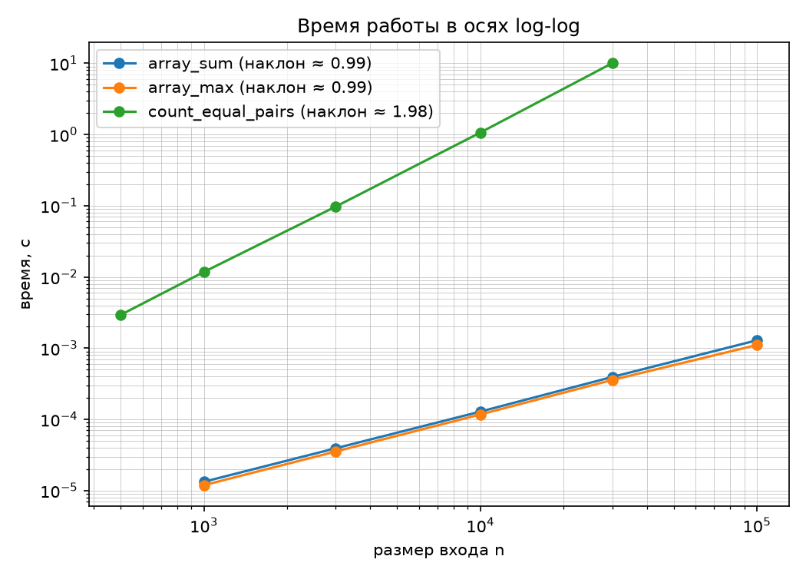
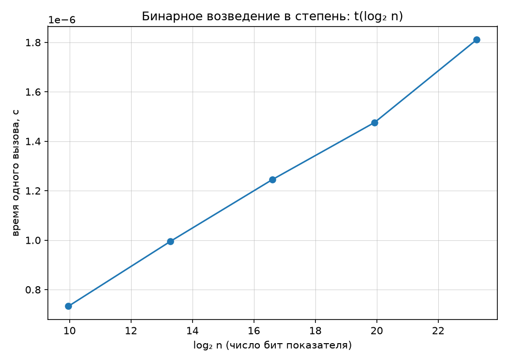

# Отчет по Лабораторной работе 1. Анализ временной сложности

## Цель работы

Научиться определять временную сложность алгоритма аналитически и подтверждать оценку экспериментально.

**Вариант:** 13, seed = 43

## 1. Реализация алгоритмов и аналитическая оценка сложности

### 1.1 Сумма элементов массива (`array_sum`)

Один цикл `for` по всем $n$ элементам массива. На каждой итерации одна операция сложения выполняется ровно $n$ раз.

Итоговая сложность: $O(n)$.

### 1.2 Поиск максимума (`array_max`)

Один цикл `for` по всем $n$ элементам массива. На каждой итерации одна операция сравнения выполняется ровно $n$ раз.

Итоговая сложность: $O(n)$.

### 1.3 Подсчёт пар равных элементов (`count_equal_pairs`)

Здесь используется вложенный цикл. Внешний выполняется $n$ раз, количество итераций внутреннего уменьшается на 1 с каждым проходом. Формула сложности:

$$t = n + (n-1) + (n-2) + (n-3) + \ldots + 1 = \frac{n(n+1)}{2} = \frac{n^2}{2} + \frac{n}{2}$$

При оценке сверху множители и младшие члены формулы отбрасываются. Остается $O(n^2)$.

### 1.4 Бинарное возведение в степень (`binary_pow`)

Здесь $n$ (размер входных данных) — это показатель степени, в которую необходимо возвести число. На каждой итерации цикла показатель целочисленно делится на 2, а запись результата (умножение текущего результата на измененное основание степени) может происходить до тех пор, пока показатель $> 0$.

Мы хотим узнать, через сколько шагов ($k$) мы дойдем до 1. Составим уравнение:

$$\frac{n}{2^k} = 1 \Rightarrow n = 2^k \Rightarrow k = \log_2 n$$

Отсюда итоговая сложность: $O(\log n)$.

## 2. Инварианты и верификация

Для проверки корректности реализаций были добавлены следующие инварианты (помимо стандартных тестов из заготовки):

- **array_sum:** Сумма массива из отрицательных чисел `[-5, -2, -3]` равна `-10`. (Проверяет корректность арифметики).
- **array_max:** Максимум массива из одинаковых элементов `[7, 7, 7]` равен `7`. (Проверяет вырожденный случай).
- **count_equal_pairs:** Для массива с уникальными элементами `[3, 8, 7, 6]` количество пар равно `0`.
- **binary_pow:** Возведение нуля в нулевую степень `binary_pow(0, 0)` возвращает `1` (математическое соглашение).

Все реализации также были сверены с эталонными функциями Python (`sum`, `max`, `pow`) на случайных входах. Расхождений не выявлено.

## 3. Эмпирические замеры и графики

Замеры проводились на данных варианта 13. Методика: прогрев, 5 повторов, взятие медианы.

*Рис. 1. Зависимость времени выполнения степенных алгоритмов от размера входа в логарифмических координатах.*

*Рис. 2. Зависимость времени выполнения бинарного возведения в степень от $\log_2 n$.*

## 4. Анализ графика для бинарного возведения в степень

Для бинарного возведения в степень теоретическая зависимость времени имеет вид $t(n) = c \cdot \log_2 n$. При построении log-log графика необходимо прологарифмировать обе части уравнения:

$$\log(t) = \log(c) + \log(\log_2 n)$$

Полученная функция $\log(\log n)$ растет экстремально медленно (например, при увеличении $n$ в миллион раз она возрастает лишь на ~2 единицы). На графике это выглядит как практически горизонтальная прямая, по которой невозможно достоверно определить порядок роста или отличить $O(\log n)$ от $O(1)$.

Поэтому используется график зависимости $t$ от $\log_2 n$ с линейными осями. В этих координатах логарифмическая зависимость превращается в четкую прямую линию $t = c \cdot x$, что позволяет наглядно подтвердить правильность аналитической оценки $O(\log n)$.

## 5. Сопоставление теории и практики для графиков сложности остальных алгоритмов

Полученные наклоны графиков в осях log-log:

- `array_sum`: 0.995 (теория: 1)
- `array_max`: 0.988 (теория: 1)
- `count_equal_pairs`: 1.982 (теория: 2)

**Объяснение расхождений:**

Небольшие расхождения между теорией и практикой (например, 1.982 вместо 2.0) объясняются двумя факторами:

- **Накладные расходы Python:** Интерпретатор тратит время на проверку типов, управление памятью и вызов функций. Это константная добавка к времени, которая сильнее влияет на малые размеры массивов.
- **Кэш процессора:** При увеличении размера данных массив перестаёт помещаться в быстрый кэш CPU, и обращения к оперативной памяти замедляют работу чуть сильнее, чем предсказывает чистая математика.

## 6. Использование генеративного ИИ

В ходе выполнения работы генеративный ИИ использовался для:

- Пояснения принципов работы бинарного возведения в степень.
- Помощи в отладке синтаксиса Markdown.
- Генерации идей для инвариантов.

Весь предложенный ИИ код был верифицирован вручную, проверен на репрезентативных тестах и сверен с эталонными реализациями Python.