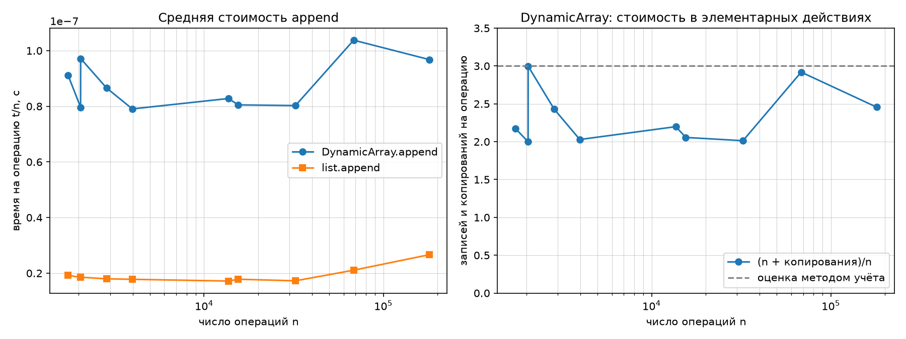
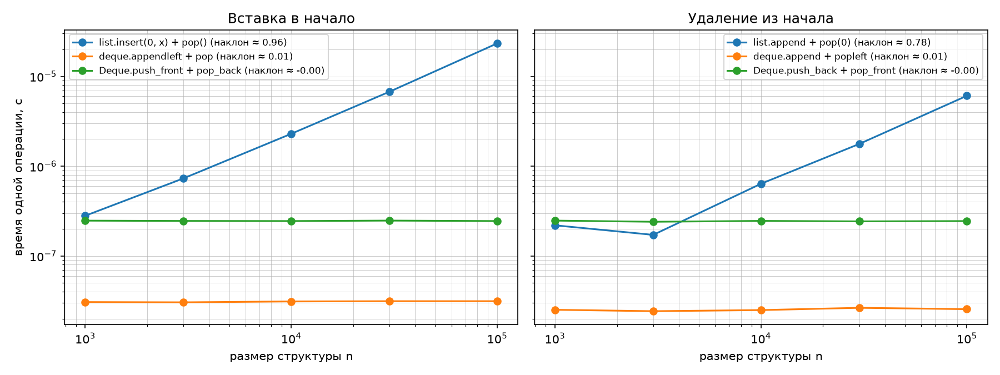

# Отчет по лабораторной работе №2 «Реализация рекурсивных функций и динамического массива, стека и дека»

**Вариант:** 13 (seed = 43)

## 1. Рекурсивные функции

### 1.1 Факториал (`factorial`)
**Реализация:** Функция возвращает `n * factorial(n-1)`. Базовый случай: при `n <= 1` возвращается 1. Каждый вызов уменьшает аргумент на 1, поэтому глубина рекурсии равна `n`.
**Сложность:** $O(n)$ — ровно `n` рекурсивных вызовов, каждый выполняется за $O(1)$.

### 1.2 Числа Фибоначчи

#### Наивная рекурсия (`fib_naive`)
**Реализация:** Прямой перевод формулы $F(n) = F(n-1) + F(n-2)$ с базовыми случаями $F(0) = 0$, $F(1) = 1$.

**Сложность:** $O(2^n)$ — экспоненциальное число вызовов из-за многократного пересчёта одних и тех же подзадач.

**Доказательство экспоненциального характера роста:**

Предположим, что функция растёт экспоненциально, т.е. $F(n) \sim r^n$. Подставим в рекуррентность:
$$r^n = r^{n-1} + r^{n-2}$$

Разделим на $r^{n-2}$ ($r \neq 0$):
$$r^2 - r - 1 = 0$$

Корни квадратного уравнения:
$$r_{1,2} = \frac{1 \pm \sqrt{5}}{2} \implies r_1 \approx 1.618, \quad r_2 \approx -0.618$$

**Микровывод:** Положительный корень $r_1 = \phi \approx 1.618$ (золотое сечение) строго больше единицы, следовательно рост экспоненциальный. Поскольку $\phi < 2$, в нотации Big-O запись упрощается до $O(2^n)$. Отрицательный корень $|r_2| < 1$, его вклад стремится к нулю и не влияет на асимптотику.

#### Мемоизация (`fib_memo`)
**Реализация:** Словарь `memo` гарантирует, что для каждого значения $k \in [0, n]$ функция вычисляется ровно один раз. Все последующие обращения возвращают результат за $O(1)$.

**Сложность:** $O(n)$ — каждая подзадача вычисляется ровно один раз.

**Строгий вывод формулы $T_{memo}(n) = 2n - 1$:**

Пусть $T(n)$ — общее количество вызовов `fib_memo(n)` при пустом словаре. При первом вызове:
1. Проверка `n in memo` отрицательна.
2. Если $n \geq 2$, выполняются два рекурсивных вызова:
   - `fib_memo(n-1)` — запускает цепочку вычислений всех значений от $0$ до $n-1$.
   - `fib_memo(n-2)` — к этому моменту значение уже в словаре, это **единственное** обращение к кэшу (1 вызов).
3. Сам вызов `fib_memo(n)` — ещё 1 вызов.

Отсюда рекуррентное соотношение:
$$T(n) = T(n-1) + 2, \quad T(1) = 1$$

Решение методом итераций:
$$
\begin{aligned}
T(n) &= T(n-1) + 2 \\
&= T(n-2) + 2 \cdot 2 \\
&= T(n-k) + 2k
\end{aligned}
$$

При $k = n-1$ достигаем базового случая $T(1)$:
$$T(n) = T(1) + 2(n-1) = 1 + 2n - 2 = 2n - 1$$

#### Таблица числа вызовов и сверка с формулами

| n | F(n) | fib_naive вызовов | Теория naive ($2F(n+1)-1$) | fib_memo вызовов | Теория memo ($2n-1$) |
|---|------|-------------------|----------------------------|------------------|----------------------|
| 5 | 5 | 15 | $2 \cdot 8 - 1 = 15$ ✅ | 9 | $2 \cdot 5 - 1 = 9$ ✅ |
| 10 | 55 | 177 | $2 \cdot 89 - 1 = 177$ ✅ | 19 | $2 \cdot 10 - 1 = 19$ ✅ |
| 15 | 610 | 1973 | $2 \cdot 987 - 1 = 1973$ ✅ | 29 | $2 \cdot 15 - 1 = 29$ ✅ |
| 20 | 6765 | 21891 | $2 \cdot 10946 - 1 = 21891$ ✅ | 39 | $2 \cdot 20 - 1 = 39$ ✅ |
| 25 | 75025 | 242785 | $2 \cdot 121393 - 1 = 242785$ ✅ | 49 | $2 \cdot 25 - 1 = 49$ ✅ |
| 30 | 832040 | 2692537 | $2 \cdot 1346269 - 1 = 2692537$ ✅ | 59 | $2 \cdot 30 - 1 = 59$ ✅ |

**Вывод:** Эмпирические данные идеально совпадают с теоретическими формулами. Переход от $O(2^n)$ к $O(n)$ подтверждает эффективность динамического программирования.

### 1.3 Ханойские башни (`hanoi`)
**Реализация:** Рекурсивный перенос $n-1$ дисков на вспомогательный стержень, перемещение самого большого диска, затем рекурсивный перенос $n-1$ дисков на целевой стержень.

**Сложность:** $\Theta(2^n)$ — точное количество ходов равно $2^n - 1$.

**Доказательство:**

Пусть $T(n)$ — минимальное количество ходов. Алгоритм выполняет три шага:
$$T(n) = 2 \cdot T(n-1) + 1, \quad T(0) = 0$$

Решение методом раскрытия рекуррентности:
$$
\begin{aligned}
T(n) &= 2 \cdot T(n-1) + 1 \\
&= 2^2 \cdot T(n-2) + 2 + 1 \\
&= 2^3 \cdot T(n-3) + 2^2 + 2 + 1 \\
&\;\;\vdots \\
&= 2^n \cdot T(0) + \sum_{i=0}^{n-1} 2^i
\end{aligned}
$$

Так как $T(0) = 0$, остаётся сумма геометрической прогрессии:
$$T(n) = \sum_{i=0}^{n-1} 2^i = \frac{2^n - 1}{2 - 1} = 2^n - 1$$

**Вывод:** Точная формула доказывает строгую экспоненциальную сложность $\Theta(2^n)$. Для $n=64$ потребуется $\approx 1.84 \times 10^{19}$ ходов, что физически невыполнимо.

## 2. Динамический массив (`DynamicArray`)

### 2.1 Реализация
- Буфер фиксированной ёмкости, заполненный `None`.
- Рост ёмкости ×2 при `size == capacity`.
- Счётчик `copies` считает количество перенесённых элементов при копировании.
- Инварианты: `0 <= size <= capacity`, `capacity >= INITIAL_CAPACITY`, `len(buffer) == capacity`, все ячейки за пределами `_size` содержат `None`.

### 2.2 Амортизированный анализ методом учёта (банковский метод)

**Амортизированная сложность** — это средняя стоимость операции за длинную серию операций, а не худший случай для одной операции. Хотя отдельная операция `append` при росте буфера стоит $O(n)$, такие операции редки, и средняя стоимость остаётся $O(1)$.

**Идея банковского метода:** Назначим каждой операции `append` стоимость 3 единицы:
- 1 единица — на саму запись элемента.
- 2 единицы — «кредит» на будущее копирование этого элемента.

**Доказательство:**
- При обычном `append` (без роста): тратим 1 единицу на запись, 2 единицы кладём в «банк».
- При росте (когда `size == capacity`): нужно скопировать все $n$ элементов. Стоимость копирования = $n$ единиц. Но в «банке» накоплено $2n$ единиц (по 2 на каждый элемент). После копирования остаётся $2n - n = n$ единиц — их хватит на следующие операции до следующего роста.

**Вывод:** Амортизированная стоимость одной операции `append` = $O(1)$, хотя отдельная операция при росте стоит $O(n)$.

### 2.3 Эмпирическая проверка

| n | t/n (DynamicArray), с | t/n (list), с | copies | (n + copies)/n |
|---|----------------------|---------------|--------|----------------|
| 1742 | 9.12e-08 | 1.93e-08 | 2044 | 2.173 |
| 2048 | 7.96e-08 | 1.85e-08 | 2044 | 1.998 |
| 2049 | 9.72e-08 | 1.85e-08 | 4092 | 2.997 |
| 2860 | 8.66e-08 | 1.80e-08 | 4092 | 2.431 |
| 3978 | 7.91e-08 | 1.78e-08 | 4092 | 2.029 |
| 13667 | 8.28e-08 | 1.72e-08 | 16380 | 2.199 |
| 15510 | 8.05e-08 | 1.78e-08 | 16380 | 2.056 |
| 32348 | 8.03e-08 | 1.73e-08 | 32764 | 2.013 |
| 68316 | 1.04e-07 | 2.11e-08 | 131068 | 2.919 |
| 180023 | 9.68e-08 | 2.66e-08 | 262140 | 2.456 |

**Наблюдение:** Отношение `(n + copies)/n` всегда < 3, что подтверждает теоретическую оценку метода учёта. При размерах, близких к степеням двойки (2048, 32348), значение близко к 2.0 (копирований мало). Сразу после роста (2049, 68316) значение приближается к 3.0 (только что было дорогое копирование). Зубчатый характер графика `append` является прямым следствием стратегии удвоения ёмкости.

*Рис. 1. Средняя стоимость append и количество копирований на операцию*

## 3. Стек и дек

### 3.1 Stack на базе DynamicArray
**Реализация:** Делегирование методов `push` → `append`, `pop` → `pop`, `peek` → `get(len-1)`.
**Сложность:** Амортизированная $O(1)$ для `push` (наследуется от `DynamicArray.append`), $O(1)$ для `pop` и `peek`.
**Инвариант:** Все элементы массива от 0 до `_size-1` должны быть не `None`.

### 3.2 Deque на базе двусвязного списка
**Реализация:** Узлы `_Node` со ссылками `prev` и `next`, указатели `_head` и `_tail`.
**Сложность:** $O(1)$ для всех четырёх операций (`push_front`, `push_back`, `pop_front`, `pop_back`) — без амортизации.
**Инварианты:** При `_size == 0`: `head == tail == None`. При `_size > 0`: `head.prev == None`, `tail.next == None`. При `_size == 1`: `head is tail`. При `_size > 1`: `head is not tail`.

### 3.3 Сравнение операций у начала структур

#### Вставка в начало

| Структура | Операция | Наклон (log-log) | Сложность |
|-----------|----------|------------------|-----------|
| list | `insert(0, x) + pop()` | 0.96 | $O(n)$ |
| collections.deque | `appendleft + pop` | 0.01 | $O(1)$ |
| Deque | `push_front + pop_back` | -0.00 | $O(1)$ |

#### Удаление из начала

| Структура | Операция | Наклон (log-log) | Сложность |
|-----------|----------|------------------|-----------|
| list | `append + pop(0)` | 0.78 | $O(n)$ |
| collections.deque | `append + popleft` | 0.01 | $O(1)$ |
| Deque | `push_back + pop_front` | -0.00 | $O(1)$ |

*Рис. 2. Время одной операции у начала структуры в зависимости от размера*

**Объяснение:**
- **list.insert(0, x) и list.pop(0):** Наклон ≈ 1.0 подтверждает линейную зависимость $O(n)$ из-за необходимости сдвига всех элементов.
- **deque и Deque:** Наклон ≈ 0.0 подтверждает константное время $O(1)$ благодаря изменению ссылок `_head`/`_tail` без сдвига данных. Небольшой отрицательный наклон у собственного Deque (-0.00) находится в пределах погрешности измерений и обусловлен накладными расходами интерпретатора Python.

### 3.4 Сравнение с эталонными реализациями

| Операция | Своя структура | Эталон | Отношение времени |
|----------|---------------|--------|-------------------|
| ops_stack.txt | 1.13e-07 с | list 3.96e-08 с | 2.8× |
| ops_deque.txt | 1.74e-07 с | collections.deque 4.09e-08 с | 4.2× |

**Объяснение:** Несмотря на одинаковую асимптотику $O(1)$, собственные структуры работают медленнее эталонных в 2.8–4.2 раза. Это объясняется накладными расходами интерпретатора Python: создание объектов `_Node` для дека, проверка типов, вызовы методов через словарь атрибутов. Эталонные реализации написаны на C, используют непрерывные блоки памяти и оптимизированы под кэш процессора. Константный множитель не влияет на асимптотическую сложность, но критичен для практической производительности.

## 4. Верификация

### 4.1 Инварианты
- **DynamicArray:** `0 <= size <= capacity`, рост ёмкости ×2, `copies` корректно считает перенесённые элементы, все ячейки за `_size` равны `None`.
- **Stack:** LIFO-порядок, `push`/`pop` согласованы, размер стека равен размеру внутреннего массива.
- **Deque:** Двусвязный список корректно обновляет `_head` и `_tail` при опустошении и наполнении; связи между узлами не нарушаются.

### 4.2 Репрезентативные тесты
- Пустая структура: `pop()` вызывает `IndexError`.
- Один элемент: `push`/`pop` работают корректно, `head is tail`.
- Опустошение и повторное наполнение: инварианты сохраняются во всех комбинациях концов.
- Серия операций через границу роста ёмкости: `copies` совпадает с теоретической формулой.
- Случайные серии (3000 операций для стека, 5000 для дека): полное совпадение с эталонными `list` и `collections.deque`.

### 4.3 Сравнение с эталоном
Все реализации сверены с эталонами на случайных сериях операций. Расхождений в результатах и размерах структур не выявлено. Амортизированная сложность `DynamicArray.append` подтверждена эмпирически: отношение `(n + copies)/n` никогда не превышает 3.

## 5. Использование генеративного ИИ

В ходе выполнения работы генеративный ИИ использовался для:
- Пояснения принципов рекурсии, мемоизации и амортизированного анализа.
- Помощи в реализации двусвязного списка и понимании механизма ссылок в Python.
- Отладки синтаксиса Python и поиска ошибок в проверках границ.
- Генерации идей для инвариантов и математических доказательств сложности.
- Формулировки текстовых разделов отчёта и оформления LaTeX-уравнений.

Весь предложенный ИИ код был верифицирован вручную, проверен на репрезентативных тестах и сверен с эталонными реализациями. Математические доказательства адаптированы под требования курса и проверены на соответствие эмпирическим данным.