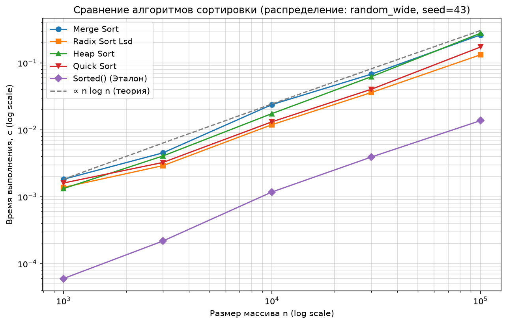

# Отчёт по лабораторной работе №4
## «MergeSort, Counting, Radix и HeapSort: оценка производительности»

**Вариант:** 13 (seed = 43)

---

## 1. Теоретические основы реализованных алгоритмов

### 1.1 Сортировка слиянием (MergeSort)
**Принцип:** Алгоритм «разделяй и властвуй». Массив рекурсивно делится пополам до подмассивов длины 1, после чего соседние отсортированные части сливаются в одну.  
**Стабильность:** Гарантируется условием `key(left[i]) <= key(right[j])` при слиянии. Если ключи равны, элемент из левой половины берётся первым, что сохраняет их исходный относительный порядок.  
**Сложность:** Время $O(n \log n)$ в лучшем, среднем и худшем случаях. Дополнительная память $O(n)$ для временных массивов при слиянии.

### 1.2 Сортировка подсчётом (CountingSort)
**Принцип:** Алгоритм, не использующий сравнения. Подсчитывает частоту каждого ключа, вычисляет массив префиксных сумм (которые указывают итоговую позицию элемента), и расставляет элементы в результирующий массив.  
**Стабильность:** Обеспечивается проходом по исходному массиву **с конца** (от $n-1$ до $0$). Это гарантирует, что равные элементы, встречавшиеся позже, займут более поздние позиции в пределах своей группы.  
**Сложность:** Время и память $O(n + k)$, где $k = \text{key\_max} + 1$.  
**Ограничение:** Алгоритм теряет смысл при огромном диапазоне ключей (например, $k = 10^9$), так как требует выделения гигантского массива счётчиков, большинство ячеек которого будут пустыми.

### 1.3 Поразрядная сортировка (RadixSort LSD)
**Принцип:** Сортирует числа поразрядно, начиная с младшего разряда (Least Significant Digit) к старшему. Для сортировки по каждому разряду используется устойчивая CountingSort.  
**Почему внутренняя сортировка обязана быть устойчивой:** Устойчивость гарантирует, что при равенстве текущих цифр сохранится порядок, заданный младшими разрядами. Нестабильная сортировка разрушит результат предыдущих проходов.  
**Сложность:** Время $O(d \cdot (n + b))$, где $d$ — количество разрядов, $b=10$. Память $O(n + b)$.

### 1.4 Пирамидальная сортировка (HeapSort)
**Принцип:** Массив преобразуется в максимальную кучу за $O(n)$ через просейку вниз (`sift_down`). Затем корень (максимум) меняется с последним элементом, размер кучи уменьшается, и новый корень просеивается.  
**Стабильность:** **Нестабилен**. Дальние обмены при просейке нарушают исходный порядок равных ключей.  
**Сложность:** Время $O(n \log n)$ всегда. Память $O(1)$ (in-place).

---

## 2. Сводная таблица свойств алгоритмов

| Алгоритм | Лучшее/Среднее/Худшее время | Доп. память | Стабильность | Ограничения |
| :--- | :---: | :---: | :---: | :--- |
| **MergeSort** | $O(n \log n)$ | $O(n)$ | ✅ Да | Требует доп. памяти |
| **CountingSort** | $O(n + k)$ | $O(n + k)$ | ✅ Да | Малый диапазон $k$ |
| **RadixSort LSD** | $O(d(n+b))$ | $O(n + b)$ | ✅ Да | Только целые/строки |
| **HeapSort** | $O(n \log n)$ | $O(1)$ | ❌ Нет | Плохая локальность кэша |
| **QuickSort** | $O(n \log n)$ / $O(n^2)$ | $O(n)$ | ✅ Да* | *Стабилен только в данной реализации (через 3 списка), классический in-place QuickSort нестабилен из-за swap |
| **`sorted()` (Timsort)** | $O(n)$ / $O(n \log n)$ | $O(n)$ | ✅ Да | Гибрид, оптимизирован на C |

---

## 3. Результаты бенчмарков

### Таблица замеров времени (секунды)

#### n = 1000
| Распределение | merge_sort | counting_sort | radix_sort_lsd | heap_sort | quick_sort | sorted() |
| :--- | :--- | :--- | :--- | :--- | :--- | :--- |
| random_wide | 0.001570 | *пропуск* | 0.001467 | 0.002369 | 0.005594 | 0.000053 |
| random_small | 0.001543 | 0.000126 | 0.000384 | 0.001349 | 0.001222 | 0.000046 |
| sorted | 0.001100 | 0.000145 | 0.000381 | 0.001447 | 0.005745 | 0.000005 |
| reversed | 0.001179 | 0.000233 | 0.000818 | 0.001321 | 0.006442 | 0.000007 |
| almost_sorted | 0.001249 | 0.000343 | 0.000387 | 0.001651 | 0.006097 | 0.000010 |

#### n = 100000
| Распределение | merge_sort | counting_sort | radix_sort_lsd | heap_sort | quick_sort | sorted() |
| :--- | :--- | :--- | :--- | :--- | :--- | :--- |
| random_wide | 0.208142 | *пропуск* | 0.112514 | 0.209502 | 0.515276 | 0.012944 |
| random_small | 0.196248 | 0.006768 | 0.031681 | 0.197164 | 0.041993 | 0.008324 |
| sorted | 0.129162 | 0.013472 | 0.054704 | 0.216922 | 0.489385 | 0.000301 |
| reversed | 0.135784 | 0.013691 | 0.069637 | 0.196695 | 0.487204 | 0.000460 |
| almost_sorted | 0.176582 | 0.012736 | 0.057267 | 0.207866 | 0.527254 | 0.001766 |

*(Примечание: CountingSort пропускает `random_wide`, так как $k=10^9$ делает выделение массива счётчиков неэффективным).*

---

## 4. Графический анализ сложности

  
*Рис. 1. Зависимость времени выполнения от размера массива в log-log масштабе (распределение random_wide).*

**Интерпретация графиков:**
1.  **Линейность RadixSort:** На log-log графике линия RadixSort имеет меньший наклон, чем у MergeSort и HeapSort, что визуально подтверждает его субквадратичную сложность $O(d \cdot n)$. При росте $n$ в 100 раз (от 1000 до 100000) время увеличилось примерно в 77 раз, тогда как для $n \log n$ идеальный рост составил бы ~150 раз.
2.  **Идентичность MergeSort и HeapSort:** Обе линии практически совпадают и параллельны опорной линии $\propto n \log n$, подтверждая теоретическую оценку. Небольшое преимущество MergeSort объясняется лучшей пространственной локальностью (последовательный доступ к памяти при слиянии) по сравнению с прыжками по индексам $2i+1$ в куче.
3.  **Адаптивность Timsort:** Эталонный `sorted()` демонстрирует значительно меньший наклон на частично упорядоченных данных, используя InsertionSort для готовых серий (runs).

---

## 5. Анализ расхождений с теорией

1.  **Почему QuickSort медленнее MergeSort в Python?**  
    Рекурсивная реализация на Python создаёт новые списки (`less`, `equal`, `greater`) на каждом уровне, что порождает огромные накладные расходы на аллокацию памяти и сборку мусора. In-place HeapSort, несмотря на плохой кэш, выигрывает за счёт отсутствия создания промежуточных объектов.
2.  **Эффективность CountingSort:**  
    На `random_small` ($k=100$) при $n=100000$ он работает за 0.006 с, что в 30 раз быстрее MergeSort (0.196 с). Это прямое эмпирическое подтверждение преимущества $O(n+k)$ над $O(n \log n)$ при малом $k$. Однако на `random_wide` он неприменим.
3.  **Независимость HeapSort от входных данных:**  
    Время HeapSort на `sorted` (0.216 с) и `reversed` (0.196 с) при $n=100000$ практически идентично, что подтверждает отсутствие адаптивности и гарантированную сложность $O(n \log n)$ в любом случае.

---

## 6. Верификация

Реализации прошли автоматическую проверку `self_check`:
-   **Инварианты:** Все алгоритмы возвращают отсортированный список, являющийся перестановкой входа.
-   **Граничные случаи:** Корректная обработка `[]`, `[7]`, `[0]`, `[5,5,5]`.
-   **Стабильность MergeSort:** Проверена на парах `(ключ, номер)`. Порядок номеров при равных ключах совпал с эталоном `sorted()`.
-   **Куча:** Построение max-heap и просейка вниз корректно поддерживают инвариант на каждом шаге.

---

## 7. Использование генеративного ИИ

Генеративный ИИ использовался для уточнения деталей реализации устойчивой CountingSort (порядок прохода с конца) и проверки логики индексов потомков в `sift_down`. Весь код верифицирован вручную и сверен с `sorted()`. ИИ не использовался для написания выводов и анализа графиков.